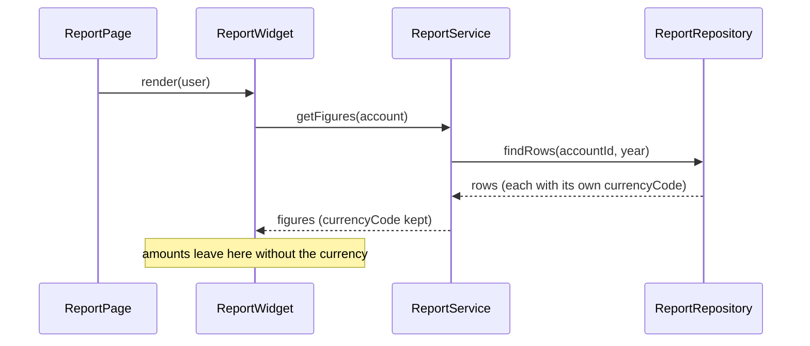

# Diagrams in the draft

A diagram belongs in the draft only when it shows something the text cannot show quickly. The default is no diagram.

## Use one when

1. **A dependency changes**: the PR adds or reverses a dependency between modules or classes, and a finding or question depends on it.
   Use a `flowchart LR`.
2. **A flow crosses three or more participants** and a finding depends on the order or the data passed (for example where a
   value loses its unit). Use a `sequenceDiagram`.
3. **A lifecycle or state** is introduced or changed (batch states, visibility windows). Use a `stateDiagram-v2` or a small timeline.

## Rules

- **Derive it from code you read.** Every node is a real class or method found in the repository. No invented components.
- **Say where it comes from** on the line right before the block: `*Derived from:* File.java, Other.java`.
  `check_draft.py` rejects a diagram without it.
- **Keep it small**: at most about 12 nodes and 40 lines. Split or cut otherwise.
- **Colour only to separate new from existing**:
  `classDef new fill:#d4edda,stroke:#28a745;` and `classDef changed fill:#fff3cd,stroke:#ffc107;`.
  Anything uncoloured is unchanged.
- **Mark the problem spot** with a short label on the edge or a note, so the reader sees why the diagram is there.
- **One diagram per concern.** If you need three, the PR is probably too big to review as one.
- GitHub renders Mermaid in Markdown. IDE previews may not: the draft stays readable as text.

## Example

*Derived from:* `ReportPage.java`, `ReportWidget.java`

